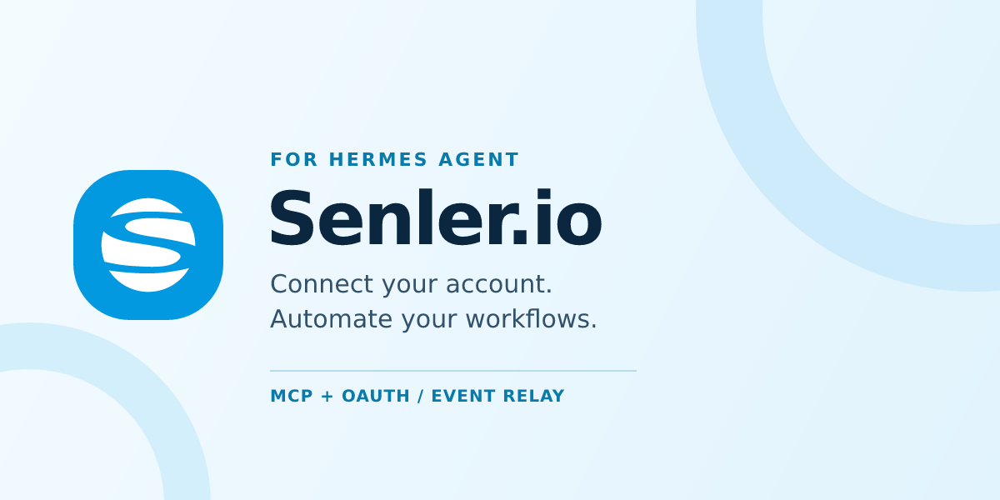

# Senler.io User for Hermes Agent

Connect your Senler.io account to Hermes through MCP OAuth and automate selected
webhook events with an outbound Relay connection. The MCP address is bundled;
each user signs in to their own account. A public IP, inbound port or tunnel is
not required for Relay.

Version **0.5.2** is a preview. The maintainer previously confirmed installation and
in-chat sign-in on native Windows Desktop. The new automatic MCP preparation still
needs a Desktop UI check. Automated tests cover connection,
installation and Relay behavior; a real Senler event workflow still needs its
own end-to-end check. See [verification details](docs/packaging.md).

## Quick start

Use a current Hermes installation with native plugins, MCP OAuth, in-chat
connection management, plugin platforms and the Relay transport. Install in the
same Hermes instance and profile that executes your agent. Git is required for
installation from this repository.

```sh
hermes plugins install SenlerBot/senler-io-user-hermes-plugin --no-enable
hermes plugins enable senler-io-user
```

When Hermes first loads the enabled plugin, it automatically prepares
`senler-io-user` in the current profile's **Connections / MCP**. Select it and
choose **Authorize** to complete native Hermes sign-in. You can also open a new
chat and ask **"Connect Senler"** to use Hermes's authorization card. No MCP URL
or OAuth settings need to be entered. The terminal alternative is `hermes senler connect`.

Then try **"List my Senler projects and their IDs. Do not change anything."**
To set up automation, name the project, event types and intended actions, for
example **"Process incoming messages in my Support project and draft replies.
Do not send them."** Hermes creates or reuses the requested subscription; Senler
activates it after the connection check succeeds. The Hermes gateway must remain
running for background processing, and Senler API/User MCP must support Hermes
Relay subscriptions. Gateway proxy mode and multiplexed profiles are not supported.

For monitoring, ask **"Watch incoming messages in Support and notify me in my
connected Telegram chat only when I need to intervene. Do not reply to customers."**
Hermes uses `senler_relay` for local setup and native MCP tools for Senler. The
recipient is resolved before subscription setup; a plain test message confirms
delivery. Quiet events produce no notification. Any selected event type can use this.

**Desktop/TUI:** plain notifications to an arbitrary local chat are not supported.
For "notify me here", select a connected messaging channel if the current surface
cannot receive messages. The plugin reports this before creating a monitor. It
does not silently use another chat or start a second agent turn. Connection,
event processing and notification delivery are checked separately.

The plugin is listed in the [official Hermes catalog](https://github.com/NousResearch/hermes-agent/blob/main/plugin-catalog/senler-io-user.yaml).
Catalog installations use the reviewed commit pinned there; newer commits from
this repository reach the catalog through a separate review. Updates use
`hermes plugins update senler-io-user`.

Version 0.5.2 prepares the MCP entry automatically on first activation in each
profile. Existing settings and authorization are preserved. Later loads respect
disabled or manually deleted connections; ask **"Connect Senler"** to restore a
deleted entry. A plugin installed with `--no-enable` waits until it is enabled
and loaded by Hermes.

Since 0.5.1 the local setup tools have their own `senler-io-setup` toolset so
they no longer hide the MCP tools under `senler-io-user` (`mcp-senler-io-user`).
After updating, restart Hermes and its running gateway on the host that executes
the agent, then open a new chat. This change keeps the saved MCP connection and
OAuth credentials; it does not require signing in again.

## Connections, permissions and local data

- **Network:** the configured MCP endpoint is
  `https://mcp-senler-io-user.senler.io/mcp?auth_mode=oauth`. Hermes owns OAuth,
  token storage and refresh. The plugin neither reads OAuth token files nor
  implements its own login client. Senler access follows the signed-in user's
  permissions. Automation also connects by WSS to the Relay address returned
  by Senler; plain WS is accepted only on localhost for development.
- **Connection setup:** first activation of the enabled plugin prepares the
  profile's MCP entry through Hermes's configuration APIs and records completion
  in its profile-scoped plugin state. `senler_connect` can also prepare the entry
  on an explicit chat request. `senler_relay` manages the local
  subscription, processing policy and notification recipient. Setup enables its platform
  in the same profile. Existing compatible MCP settings are preserved. Activation
  only saves connection settings; the plugin does not invoke OAuth, create a
  subscription or send a customer message. Hermes owns subsequent MCP discovery
  and sign-in.
- **Background execution:** the `senler-io` platform runs inside the Hermes
  gateway after the operator configures automation. Its authenticated events
  use `trusted_inbound` and bypass Hermes's user-pairing/allowlist flow. The
  adapter checks the saved project, subscription and event selection, disables
  gateway commands, and treats customer content as untrusted input. Saved
  operator instructions determine permitted actions; sending a reply requires
  an explicit send policy or direct request.
- **Stored data:** the active Hermes profile contains `senler-io-relay.sqlite3`
  and its lock/journal files. The SQLite database stores subscription-specific
  Relay credentials, operator instructions, event payloads, result reports and
  notification recipients. At most 1,000 pending notifications are retained for
  seven days. Latest delivery/test receipts are stored per subscription. A saved
  final decision is sent through the selected native Hermes messaging adapter;
  no additional model call is used for notification delivery.
  It is not encrypted by the plugin; protect the profile directory and backups.
  Event runs also create normal Hermes sessions. Event content is processed by
  the model provider selected in Hermes, and result reports of up to 16,000
  characters are sent back to Senler. The gateway log may contain a short
  preview. These workflow reports are not optional analytics; the plugin adds
  no separate telemetry.
- **Commands:** the terminal connection helper invokes Hermes's own MCP CLI
  using the same Python interpreter and profile. The bundled PowerShell scripts
  invoke local Hermes commands for installation or Relay setup; Relay credentials
  are passed through JSON stdin, not command-line arguments. The plugin reads its
  own bundled settings/skills, its SQLite state and the profile configuration
  through Hermes APIs. It does not replace Hermes core code or update itself.
- **Stopping and removing:** pause the local processor and disable its Senler
  subscription before removal. Removing the plugin does not revoke MCP access
  or subscription credentials, and does not erase the profile's Relay database
  or Hermes sessions. Review uncertain actions before retrying interrupted jobs;
  the plugin does not promise exactly-once execution for arbitrary MCP writes.

Registered capabilities: two tools (`senler_connect`, `senler_relay`), two hooks (`pre_tool_call`,
`on_session_end`), two skills (`senler-io-user`, `senler-io-incoming`), the `senler`
CLI command and the `senler-io` platform. No plugin-specific Python dependencies,
environment secrets, Desktop JavaScript, or standalone background service are
installed. The command and skill descriptions are in English; detailed Windows
instructions below are in Russian. Source code is licensed under MIT.

## Русская инструкция

### Senler.io User для Hermes Agent

Плагин содержит настройки подключения к пользовательскому MCP-серверу Senler.io,
подключение из чата и два skill: работу с User MCP и обработку входящих. Адрес сервера
и параметры OAuth уже в пакете; пользователь входит в свой аккаунт Senler.
Данные и действия доступны с правами этого пользователя.

Версия 0.5.2 — предварительный выпуск с автоматическим добавлением MCP,
настройкой подписки из чата и уведомлениями
о событиях, требующих внимания. Hermes использует инструмент `senler_relay`;
самостоятельно писать Python-скрипты для MCP или настраивать Relay через консоль не нужно.
Вебхук типа Hermes создаётся без URL: Senler выдаёт адрес подключения,
плагин подключается к нему и подписка включается после автоматической проверки.
Владелец установки ранее подтвердил установку и вход из чата Windows Desktop;
новое автоматическое добавление MCP в интерфейсе и обработка настоящего события
требуют отдельной проверки.
Новые возможности требуют соответствующего обновления
Senler API и User MCP; ZIP не обновляет серверы Senler.

## Установка из GitHub на Windows

Нужен актуальный Hermes с нативными плагинами, регистрацией платформ, Relay transport и OAuth для MCP, а также Git. Используйте тот же Hermes и
каталог данных, что и в Desktop; подключение Desktop к другому компьютеру
требует установки на том компьютере.

```powershell
hermes --version
hermes plugins install SenlerBot/senler-io-user-hermes-plugin --no-enable
hermes plugins enable senler-io-user
```

После первого включения и загрузки плагина откройте **Connections / MCP**:
`senler-io-user` добавляется автоматически. Выберите его и нажмите **Authorize / Авторизоваться**.
Другой вариант — новый чат Hermes и просьба **«Подключи Senler»**: Hermes покажет
штатную карточку входа. Адрес MCP и параметры OAuth уже заполнены.
Подробности — в разделе **Подключение Senler** ниже. Публикация в официальном каталоге Hermes для установки
из этого репозитория не требуется. Если копия из ZIP уже установлена,
сначала выполните переход на GitHub-версию по разделу **Обновление** ниже.

## Установка из ZIP на Windows

Скачайте ZIP из [GitHub Releases](https://github.com/SenlerBot/senler-io-user-hermes-plugin/releases).
Откройте PowerShell в распакованной папке, рядом с `plugin.yaml`:

```powershell
powershell -NoProfile -ExecutionPolicy Bypass -File .\install.ps1
```

`ExecutionPolicy Bypass` действует только для этого процесса. Скрипт проверяет
пакет командой `hermes plugins validate`, копирует файлы и включает плагин
штатной командой Hermes. Существующая копия не перезаписывается.

Каталог данных берётся из `HERMES_HOME`, иначе используется современный
Windows-каталог `%LOCALAPPDATA%\hermes`. Перед записью проверяется наличие
`config.yaml`. Для другой установки или профиля укажите фактический каталог
его `config.yaml`:

```powershell
powershell -NoProfile -ExecutionPolicy Bypass -File .\install.ps1 -HermesHome 'C:\path\to\hermes-home'
```

Для предварительного просмотра добавьте `-WhatIf`. Если команда `hermes` не
найдена, откройте новый PowerShell или передайте фактический путь к CLI через
`-HermesCommand`. Скрипт не устанавливает и не обновляет сам Hermes.

## Подключение Senler

После включения и загрузки плагина `senler-io-user` появляется в
**Connections / MCP** того же профиля. Выберите подключение и нажмите
**Authorize / Авторизоваться**, чтобы пройти штатный вход Hermes.
Если подключение было выключено ранее, сначала включите его в этом разделе.

Для подключения через чат откройте новый чат **того же профиля Hermes** и напишите:

> Подключи Senler.

Плагин подготовит подключение из [mcp-server.json](mcp-server.json), затем Hermes
покажет штатную карточку авторизации. Нажмите кнопку открытия браузера и пройдите
вход в Senler. После подтверждения Hermes проверит подключение и загрузит инструменты.
Сохранённая рабочая авторизация используется повторно. При отмене или ошибке
Hermes сообщит результат; настройка обработки событий продолжаться не должна.

Для карточки нужны поддержка подключения MCP из чата и доступный в сессии
инструмент Hermes `manage_connections`. Если он недоступен, подготовленное
подключение будет в разделе **подключений / MCP** Desktop: выберите
`senler-io-user` и нажмите **Authorize / Авторизоваться**. Настройки уже заполнены.
Если подключение было выключено, сначала включите его в том же разделе.

После входа попросите:

> Покажи доступные мне проекты Senler: названия и ID. Ничего не изменяй.

Можно сразу попросить обработку входящих: если подключения ещё нет, Hermes
сначала предложит вход, затем продолжит настройку. Конфликтующее подключение
с тем же именем плагин сохраняет и предлагает проверить в настройках.
Hermes хранит и обновляет OAuth-токены самостоятельно.

Первое включение и загрузка плагина добавляют MCP автоматически; загрузка файлов
без включения этого не делает. Совместимое подключение сохраняется с прежними
настройками. Удалённая после настройки запись не восстанавливается при каждом
запуске: для её возврата попросите «Подключи Senler». Фоновое событие не может
запускать вход. Полный сценарий проверки — [docs/windows-test.md](docs/windows-test.md).

### Подключение через терминал

Для серверов и пользователей терминала остаётся команда:

```powershell
hermes senler connect
```

Пройдите вход по ссылке Hermes и завершите вопросы подключения в терминале.
Если при установке вы передавали `-HermesHome`, сначала задайте `$env:HERMES_HOME`
с тем же путём в этом PowerShell. Desktop тоже должен использовать этот профиль.

Проверка:

```powershell
hermes plugins list
hermes senler check
```

Повторный `connect` проверяет существующее подключение, сохраняя его настройки
и выбранные инструменты. Hermes использует сохранённые токены, обновляет их
или запрашивает вход, если они больше не работают. Для принудительного нового
входа выполните:

```powershell
hermes senler connect --reauthorize
```

Если под именем `senler-io-user` уже настроен другой сервер или подключение
выключено, команда объяснит причину и сохранит настройки. Адрес и параметры
подключения находятся в `mcp-server.json`; вручную копировать их не нужно.

## Автоматическая обработка событий

Агент и плагин должны работать в одном экземпляре Hermes — на компьютере или
сервере; модель может быть облачной. Режим пересылки задач другому экземпляру
Hermes (`gateway.proxy_url` / `GATEWAY_PROXY_URL`) для входящих событий пока
не поддерживается: плагин проверяет его при настройке, возобновлении и запуске gateway.
Во время работы проверка повторяется перед каждым заданием. При несовместимой
настройке новые задания ждут; причина видна в `hermes senler relay status`
как `processing_blocked_reason`. После исправления настройки ожидание снимается
автоматически, ручная пауза сохраняется. Срок ожидания событий — до 24 часов;
готовые отчёты продолжают отправляться. Место выполнения агента следует менять
с остановкой и последующим запуском gateway.

Публичный IP, домен и открытые входящие порты не нужны: Hermes сам подключается
к Senler. В обычном чате можно попросить:

> Обрабатывай входящие сообщения проекта «Учебный»: классифицируй вопрос и
> готовь черновик ответа. Сообщения клиентам пока не отправляй.

Hermes создаст подписку, проверит приём и включит её в рамках той же просьбы.
Можно выбрать другие события, отдельные каналы, изменить правила или поставить
обработку на паузу. User OAuth остаётся одним на пользователя; каждая подписка
привязана к выбранному проекту.

В новом чате Hermes сначала находит сохранённые подключения. Повторная просьба
использует прежний сценарий и ID вебхука. При остановке сначала выключается
локальный обработчик, затем подписка Senler. Если Senler или OAuth недоступны,
Hermes сообщает, что обработчик остановлен локально, а отключение подписки ещё
не подтверждено. Новые вызовы инструментов остановленной попытки блокируются;
уже отправленное внешнее действие может завершиться. Сохранённый отчёт доставляется
в Senler даже на локальной паузе, без возобновления обработки событий.

Результат сохраняется в сессии обработки Hermes и передаётся в историю подписки Senler (до 16 000 символов). Чтобы увидеть результаты,
попросите: «Покажи последние черновики обработки Senler проекта „Учебный“».
Плагин помогает найти сохранённые ответы в истории сессий; они не появляются
автоматически в исходном чате и не сохраняются как черновики в Senler.
Журнал gateway содержит только короткое начало ответа.

Для уведомлений попросите: «Следи за входящими проекта „Учебный“ и присылай кратко
в мой подключённый Telegram, только если требуется моё внимание. Клиентам не отвечай».
Hermes уточнит получателя, сохранит правило и проверит доставку тестовым сообщением.
Обычные события останутся без уведомлений. Для других событий действуют их собственные
правила. «Присылай сюда» поддерживается для чата в подключённом мессенджере.
Для произвольного чата Desktop/TUI Hermes сообщит об ограничении до создания подписки
и предложит выбрать подключённый канал.

Статус различает сохранённые настройки, свежий сигнал Relay, итог обработки и
подтверждение доставки уведомления. При недоступном канале и подтверждённом ограничении
частоты повторяется готовый текст, без нового задания модели. При неизвестном исходе
отправки автоматического повтора нет: сначала нужно проверить чат получателя.
Локальная пауза сохраняет доставку уже подготовленных уведомлений. Смена или отключение
получателя удаляет ещё не отправленные уведомления старому адресату.

Пакет не запускает listener, не создаёт подписки, не отправляет сообщения при
установке и не добавляет фоновый опрос диалогов.

## Обновление

В 0.5.2 MCP добавляется автоматически при первой загрузке включённого плагина
в каждом профиле. Обновление сохраняет существующее подключение, его выключенное
состояние и авторизацию. Если запись отсутствует, она будет подготовлена без
отдельной просьбы в чате. После этого намеренно удалённая запись сама не возвращается.

В 0.5.1 исправлен конфликт имён: локальные действия `senler_connect` и `senler_relay`
получили отдельный набор `senler-io-setup`. MCP по-прежнему называется `senler-io-user`
и использует набор `mcp-senler-io-user` с коротким именем `senler-io-user`.
Если вы вручную выбираете наборы инструментов, эти имена относятся к разным
действиям. Уже добавленный `mcp-senler-io-user` продолжит работать. Настройки
подключения и сохранённая авторизация остаются прежними; исправление не требует
повторного входа или правки конфигурации.

Если раньше был настроен HTTP-приёмник из версии 0.3, перед обновлением поставьте
его вебхук в Senler на паузу и дождитесь завершения выполняющихся заданий.
Удалите прежний маршрут штатными средствами Hermes. После обновления создайте
подписку типа Hermes. Тип существующего HTTP-вебхука не меняется автоматически.
Это разовый переход: в версии 0.4 плагин использует только Relay для получения событий.

Копия, установленная из GitHub, обновляется штатной командой:

```powershell
hermes plugins update senler-io-user
```

ZIP-копия не имеет Git-источника для `hermes plugins update`. Перед заменой
сохраните свои правки внутри папки плагина, если они есть. Удалите только этот
плагин штатной командой, затем выполните установку из GitHub выше или установите
новую ZIP-версию:

```powershell
hermes plugins remove senler-io-user
```

После обновления перезапустите Hermes и работающий gateway на компьютере или
сервере, который выполняет запросы. Переключение MCP в Desktop не перезагружает
код плагина. Затем откройте новый чат в нужном профиле и напишите **«Подключи Senler»**.
Сохранённое MCP-подключение будет использовано с его прежними настройками.
Если плагин выключен, включите его в интерфейсе или командой
`hermes plugins enable senler-io-user`.

Настройки Relay и очередь находятся
в профиле Hermes и сохраняются при замене файлов плагина. Ручная пауза остаётся
в силе. Перед полным удалением попросите отключить соответствующие подписки
Senler; само удаление пакета не отзывает MCP-доступ и ключи подписок.

Исходники и выпуски: [SenlerBot/senler-io-user-hermes-plugin](https://github.com/SenlerBot/senler-io-user-hermes-plugin).
Не добавляйте в репозиторий папку данных Hermes, OAuth-токены и `senler-io-relay.sqlite3`.

## Логотип и формат пакета

В `assets/icon.svg` включена точная копия логотипа кабинета Senler.io из
`aibot-cabinet/public/senler-logo.svg`: голубой знак со звездой, цвет `#00ADFF`.
Этот же знак используется в баннере README и копируется при установке.
Пакет использует нативный `plugin.yaml` и Python-точку входа: они регистрируют
действие подключения из чата, CLI-команду, skills и платформу Senler Relay.

Изображение карточки в каталоге Hermes задаётся отдельным полем `image` в записи
этого каталога. Наличие SVG в ZIP само по себе не назначает значок плагину в
Desktop. Плагин уже принят в каталог; новые версии и изображения появляются
там после отдельного обновления записи. Подробности проверки и публикации —
[docs/packaging.md](docs/packaging.md).

## Проверки разработчика

Проба регистрации из валидатора Hermes на указанном в
[packaging.md](docs/packaging.md) коммите проверяет импорт нативного плагина
и команду `senler`. Тесты подключения проверяют OAuth-команды, сохранение
существующих настроек и обработку отмены или ошибок. Проверка установщика выполняется в PowerShell с тестовой
командой вместо Hermes, во временном каталоге: проверяются успешная установка,
копирование логотипа, пути с пробелами, `-WhatIf`, сохранение старой копии
и остановка при ошибках.

```powershell
powershell -NoProfile -ExecutionPolicy Bypass -File .\tests\install.Tests.ps1
powershell -NoProfile -ExecutionPolicy Bypass -File .\tests\run-relay.Tests.ps1
python -m unittest discover -s tests -p 'test_*.py'
```

Эти проверки не выполняют вход в Senler и не заменяют тест в настоящем Hermes.

## Источники совместимости

Проверено по документации Hermes 11 октября 2026; проверенный коммит исходников
указан в [docs/packaging.md](docs/packaging.md).

- [Нативные плагины Hermes](https://hermes-agent.nousresearch.com/docs/developer-guide/plugins)
- [Native Windows](https://hermes-agent.nousresearch.com/docs/user-guide/windows-native)
- [MCP OAuth](https://hermes-agent.nousresearch.com/docs/user-guide/features/mcp/#oauth-authenticated-http-servers)
- [Похожая схема OAuth-установки](https://hermes-agent.nousresearch.com/docs/plugins/letsfg)
